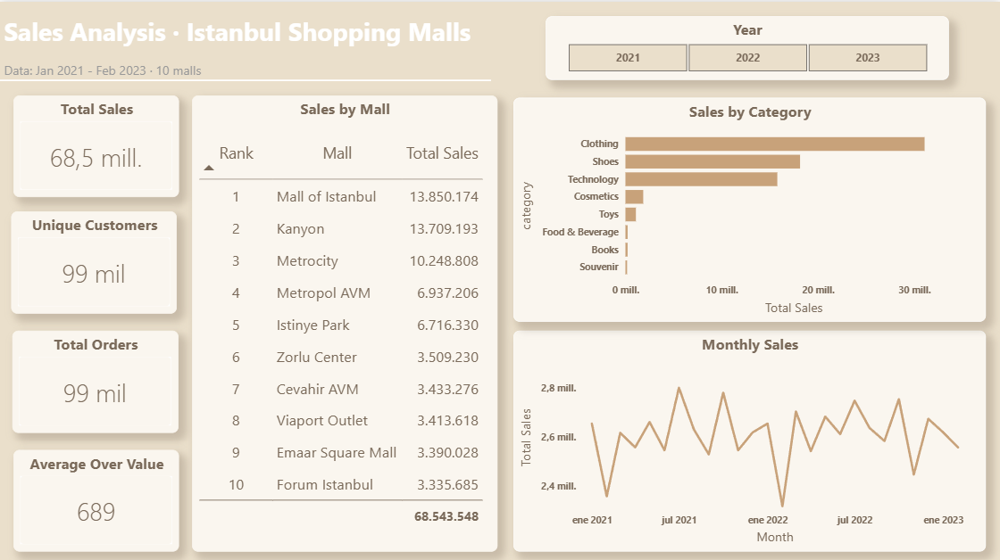
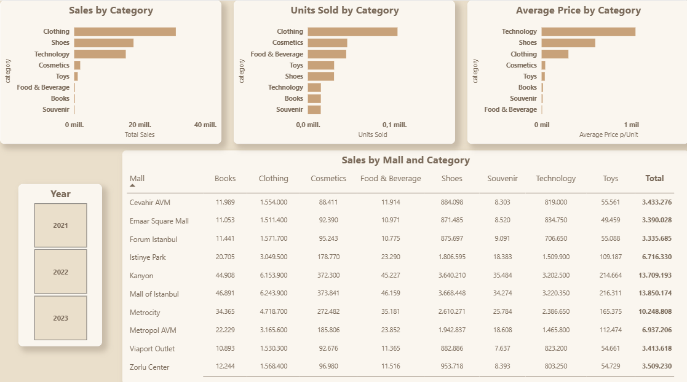
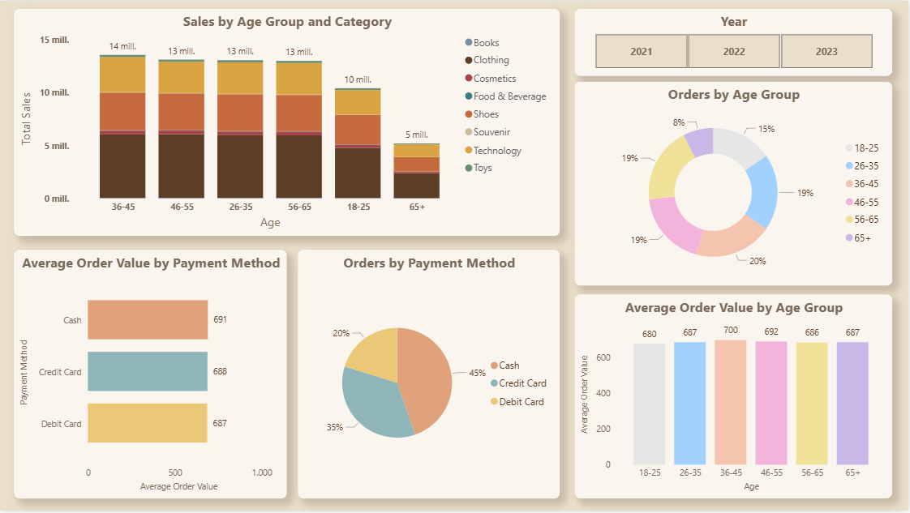

# Istanbul Retail Sales Dashboard

Power BI dashboard analysing retail sales across 10 Istanbul shopping malls (Python + Power BI).

## Goal

Understand where sales come from (malls, categories, customers) and which factors do, and do not, change how much customers spend.

## Dataset

[Customer Shopping Dataset (Kaggle)](https://www.kaggle.com/datasets/mehmettahiraslan/customer-shopping-dataset): 99,457 orders, 10 columns, Jan 2021 - Mar 2023, 10 shopping malls. Amounts are in Turkish lira (TL).

## Process

1. **Cleaning (Python, pandas):** [write here what you did: data types, nulls, duplicates, outliers...]
2. **Modelling (Power BI):** calendar table, measures organised in folders (core KPIs, ranking, Pareto, segments, time calculations).
3. **Dashboard:** 3 pages: Summary, Products & Malls, Customers.

## Key findings

- **Sales:** 68.5M TL across 99,457 orders, with an average order value of about 689 TL.
- **Categories:** Clothing leads in both sales and units sold. Shoes and Technology sell fewer units but at higher prices, while Cosmetics and Food & Beverage sell many units for little revenue.
- **Malls:** the top 3 malls (Mall of Istanbul, Kanyon, Metrocity) generate 55% of sales and the top 5 generate 75%. The bottom 5 malls are almost identical (about 3.4M TL each).
- **Same mix everywhere:** all malls sell the same category mix (Clothing is about 45% in each), so malls differ in size, not in what they sell.
- **Customers:** age group and payment method do not change average order value (about 680-700 TL in every group). Cash is the most used method (45%), followed by credit card (35%) and debit card (20%).
- **Time:** monthly sales are stable (about 2.6M TL) with no clear seasonality. March 2023 is incomplete in the source data and is excluded from the trend.

The data appears synthetic, which explains the uniform behaviour across segments.

## Pages

| Summary | Products & Malls | Customers |
|---|---|---|
|  |  |  |

## Tools

Python (pandas), Power BI (DAX, Power Query).

## Files

- [`Istanbul Retail.pbix`](Istanbul%20Retail.pbix): Power BI report
- [`Python.pdf`](Python.pdf): data cleaning (Python)
- [`images/`](images): dashboard screenshots
